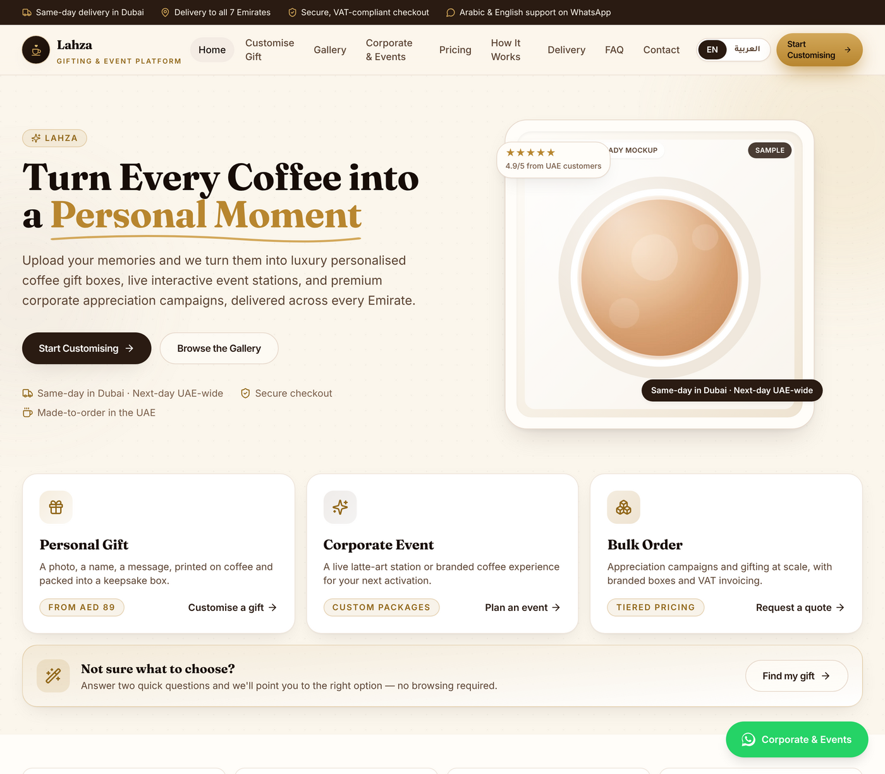
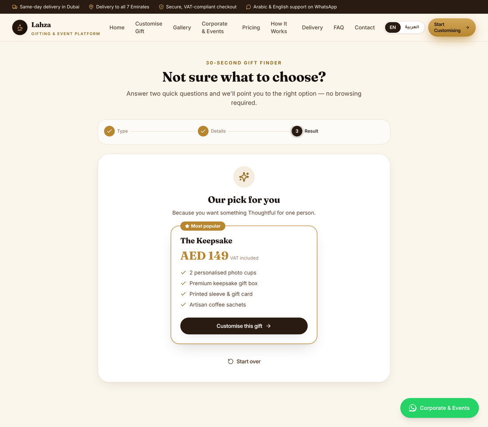

# Lahza · لحظة

<p>
  
  
  
  
  
  
</p>

A premium, **UAE-ready bilingual (EN/AR) SaaS commerce platform** for
personalised coffee gifts, live event coffee stations, and corporate
appreciation campaigns, operated by **Beyond Connect General Trading L.L.C**.

<p align="center"><br><sub><em>Concept image (AI-generated). Not a product screenshot.</em></sub></p>

This is the customer-facing storefront + a demo operations console: a Vite +
React app at the **repository root**, which Vercel and Netlify build directly
with no subfolder configuration. It is also an installable **PWA** (add to home
screen on Android/iOS).

> This repository also hosts a second, independent product line (**Wisal**) in
> sibling folders. The root build is Lahza only. See **[PROJECTS.md](./PROJECTS.md)**
> for the full project map and how to deploy or split each project separately.

> Mobile-first · conversion-focused · Arabic RTL-quality · UAE-compliance-ready.

## Screenshots

| Home | Smart Gift Finder |
| --- | --- |
|  |  |

## Stack

- **Vite + React 18 + TypeScript**
- **Tailwind CSS** with logical properties (`ps`/`pe`/`ms`/`me`) so layouts
  mirror automatically in Arabic RTL
- **react-router-dom** with route-level code splitting
- Lightweight custom **i18n** (`src/i18n`) — EN source of truth, AR mirrored and
  type-enforced to the same shape; switches `document.dir` instantly
- Zero heavy runtime deps (no chart/animation/PDF libraries) to protect
  Lighthouse / LCP / INP / CLS

## Quick start

```bash
# the Lahza app is the repository root — run these from the repo root
npm install
npm run dev        # http://localhost:5173
npm run build      # tsc --noEmit + vite build
npm run preview
```

## What's inside

| Area | Where |
| --- | --- |
| Home + 3 above-the-fold paths (Personal · Corporate · Bulk) | `src/pages/Home.tsx`, `components/CustomerPaths.tsx` |
| **Smart Gift Finder** — 2-question quiz that recommends a real package | `src/pages/GiftFinder.tsx` at `/gift-finder`, `lib/giftWizard.ts` |
| Mobile header with hamburger | `components/Header.tsx` |
| Non-overlapping WhatsApp FAB | `components/WhatsAppFab.tsx` (icon-only on mobile; `<main>` reserves bottom padding) |
| Customisation flow (7 steps) | `src/pages/Customize.tsx`, `pages/customize/*` |
| Live cup/sleeve/box/card preview | `components/ProductPreview.tsx` (SVG, no image weight) |
| Corporate flow + **PDF quotation** | `src/pages/Corporate.tsx` (print-to-PDF), `lib/quotation.ts` |
| Operations console | `src/pages/admin/Admin.tsx` at `/console` |
| Bilingual dictionaries | `src/i18n/en.ts`, `src/i18n/ar.ts` |
| Pricing / gallery / delivery / legal | `src/pages/*`, `lib/catalog.ts` |
| Seller identity + VAT + compliance config | `src/lib/brand.ts` |

### Customisation flow steps

Upload → **image-quality validation** → live preview (cup/sleeve/box/card) →
gift message (AR/EN) → package → delivery Emirate & date/time → review →
pay online **or** request a WhatsApp payment link. Personalised-goods
non-returnable notice + PDPL photo consent are enforced in-flow.

### Smart Gift Finder (`src/pages/GiftFinder.tsx`, `lib/giftWizard.ts`)

A short, interactive quiz at **`/gift-finder`** — linked from the home page,
footer, and site navigation — that removes the guesswork of choosing between
the three customer paths:

1. **What are you planning?** — a personal gift, a live event station, or
   gifts for a team/client list.
2. A path-specific follow-up: *how should it feel* (personal), *about how
   many guests* (event), or *about how many people* (bulk).
3. A result screen with the matched package name, real price, and what's
   included, plus a one-click CTA — straight into `/customize` with the
   package pre-selected, or to the Corporate quote form.

The recommendation logic (`lib/giftWizard.ts`) is a small, pure, deterministic
function with no AI call and no invented pricing — every result only ever
points at a package or tier already defined in `lib/catalog.ts`, the same
source of truth used by `Pricing.tsx` and `Corporate.tsx`, so a recommendation
can never promise something checkout can't honour.

### AI features (`src/lib/ai.ts`)

All behind small, swappable interfaces. They run offline/deterministically out
of the box; set `VITE_AI_ENDPOINT` to route generation + image moderation to a
real provider (OpenAI / Anthropic / Gemini / Firefly).

- AI image cleanup + auto-crop for cup/box (canvas, client-side)
- Arabic name spelling assistant (curated map + flagged phonetic fallback)
- Gift-message generator (tone × language)
- Corporate proposal + event-package recommender
- Image moderation seam before checkout

## UAE compliance readiness

Built to a UAE e-commerce compliance brief (Consumer Protection & E-Commerce
Law, VAT/FTA invoicing, and PDPL for photo uploads). See
[`docs/THREAT_MODEL.md`](docs/THREAT_MODEL.md) for the security view:

- **Seller identity** (legal name, licence authority, licence no., TRN, address)
  shown in footer, contact, checkout and on the quotation — edit in
  `src/lib/brand.ts` (`TODO` values must be confirmed before launch).
- **VAT-inclusive** consumer pricing; **VAT-exclusive** B2B with a full tax
  invoice / quotation; 5% VAT wording throughout.
- **Personalised-goods non-returnable** notice at checkout.
- **PDPL**: explicit photo-upload consent, stated 30-day auto-deletion of source
  photos, and a bilingual Privacy Policy covering retention, sharing,
  cross-border transfers, children and AI processing.
- Bilingual **Terms**, **Refund & Cancellation** and **Delivery** policies.

> The seller licence number and TRN are placeholders — confirm and set them in
> `src/lib/brand.ts`. Payment, WhatsApp Business API and real AI/moderation keys
> belong on a server, never in the client bundle.

## Performance notes

- Route-level `lazy()` splitting; home ships a small bundle.
- Fonts preconnected with `display=swap`; SVG/gradient mockups instead of
  hero images (no CLS, no large LCP image).
- `prefers-reduced-motion` respected; all interactive controls are keyboard-
  and screen-reader-labelled; skip-to-content link included.

## Recommended production wiring

- Payments: **Telr** or **PayTabs** + **Tabby** + **Tamara** + Apple/Google Pay
  + COD + corporate payment links.
- Hosting/data residency: UAE cloud region for photos & invoice data; per-object
  lifecycle rules to auto-purge source images after fulfilment.
- WhatsApp Business API via a BSP for order/utility/OTP messages.

---

## Also in this repository

| Project | Path | What it is |
| --- | --- | --- |
| **Beyond Style UAE landing page** | [`landing/`](landing/) | Bilingual (Arabic-first/EN) static landing page for the personalized-jewelry brand — WhatsApp + Google Form ordering, no build step. Deployed to GitHub Pages by [`deploy-landing.yml`](.github/workflows/deploy-landing.yml). See [`landing/README.md`](landing/README.md). |
| Android wife assistant | `android-wife-assistant/` | Native Android app (CI builds via [`android.yml`](.github/workflows/android.yml)) |
| Telegram wife assistant | `telegram-wife-assistant/` | Telegram bot companion |
| Wisal web | `wisal-web/` | Web app |
